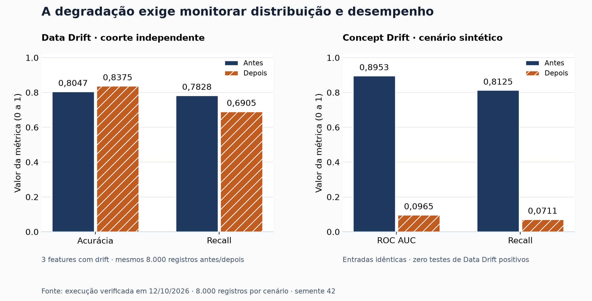
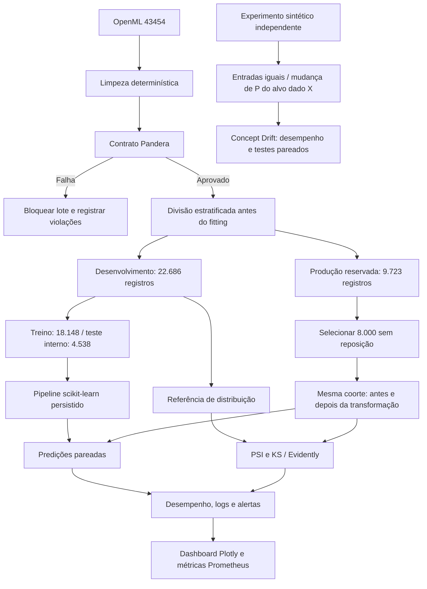
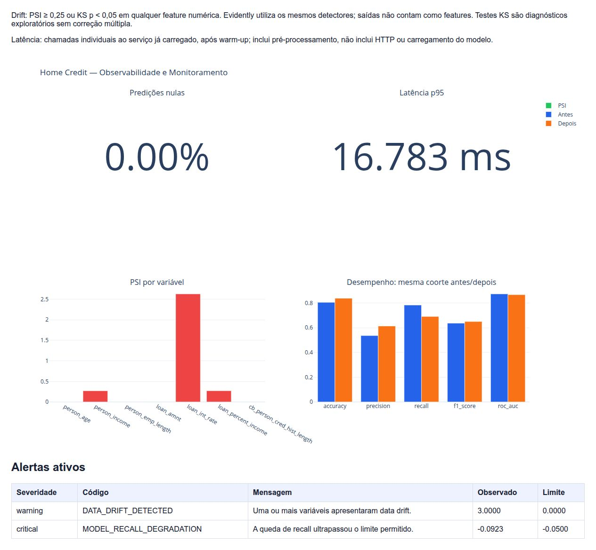
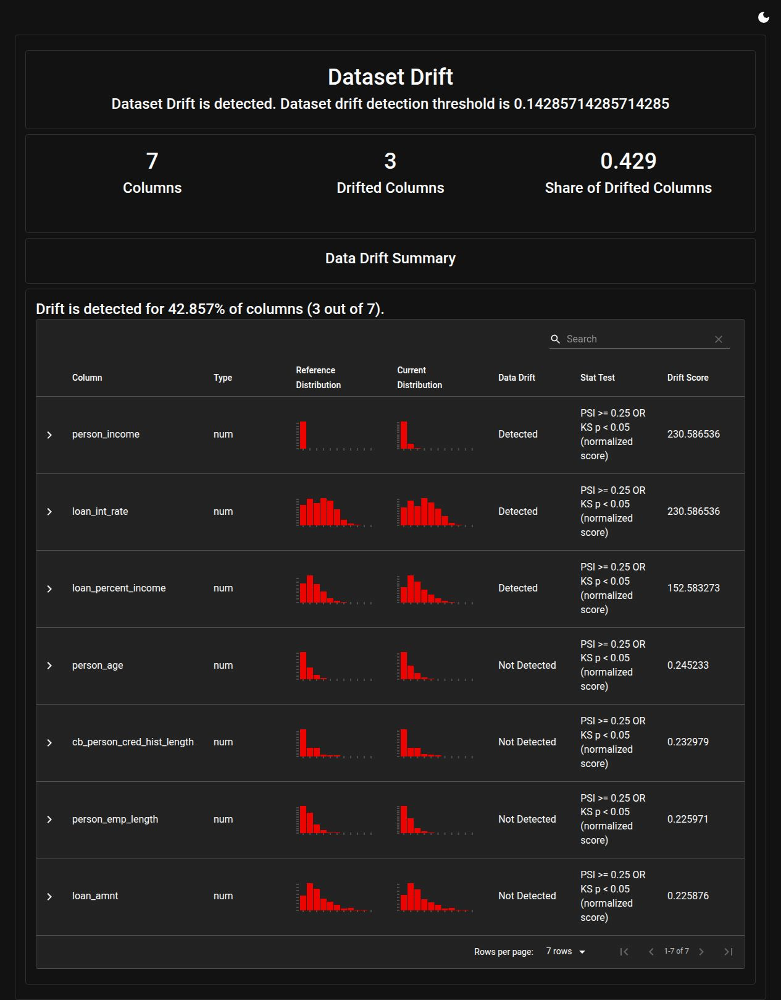

# Credit Risk Observability

**Qualidade de dados, detecção de drift e governança para um modelo de risco de crédito.**

Projeto acadêmico da Fase 4 de Machine Learning Engineering: uma camada de sustentação que bloqueia dados inválidos, identifica mudanças de distribuição e torna a degradação do modelo visível por relatórios, métricas e alertas.

O cenário central mostra por que uma acurácia maior pode esconder um problema: depois da simulação de Data Drift, a acurácia sobe, mas o recall cai **9,23 pontos percentuais**. Um segundo experimento demonstra **Concept Drift com entradas exatamente iguais**, mostrando o limite de monitorar apenas a distribuição das features.

| Estado do projeto | Evidência |
|---|---|
| Versão do pacote | `0.4.0` |
| Validação automatizada | **28 testes aprovados**, Ruff, formatação, Mypy e build |
| Dataset real | OpenML 43454; **32.409 registros** após limpeza |
| Produção simulada | **8.000 registros**, reservados antes do treinamento |
| Data Drift | **3 features afetadas**, 6 de 14 testes positivos |
| Concept Drift | Zero testes de drift positivos nas entradas; ROC AUC **0,8953 → 0,0965** |
| Vídeo STAR | Gravado; roteiro disponível |

> **Escopo:** o sistema monitora um modelo acadêmico. Não concede crédito real. A execução é por lote, iniciada pela CLI; não há serviço de monitoramento continuamente agendado. As políticas de segurança e LGPD são propostas documentadas, não certificação de conformidade em produção.



*Figura 1 — Resultados reais dos dois experimentos executados, com 8.000 registros por cenário e semente 42. O cenário de Concept Drift é inteiramente sintético e deliberadamente intenso. Fonte: [métricas agregadas](docs/evidence/results.json).*

## Sumário

- [1. Resumo executivo e requisitos](#resumo)
- [2. Reprodução do projeto](#reproducao)
- [3. Arquitetura e desenho de avaliação](#arquitetura)
- [4. Qualidade de dados e baseline](#qualidade)
- [5. Data Drift e impacto no desempenho](#data-drift)
- [6. Concept Drift controlado](#concept-drift)
- [7. Observabilidade e evidências visuais](#observabilidade)
- [8. Governança, privacidade e causalidade](#governanca)
- [9. Validação técnica](#validacao)
- [10. Artefatos e documentação](#artefatos)
- [11. Troubleshooting](#troubleshooting)
- [12. Vídeo STAR e próximos passos](#video)

<a id="resumo"></a>

## 1. Resumo executivo e requisitos

Uma fintech pode perder capacidade de identificar inadimplência mesmo com o pipeline executando normalmente. Este projeto investiga três perguntas: os dados respeitam o contrato? As distribuições mudaram? O modelo continua identificando a classe de risco?

A solução combina **Pandera**, **scikit-learn**, **PSI e Kolmogorov–Smirnov**, **Evidently**, **Plotly**, logs JSONL e métricas exportadas em formato Prometheus. A decisão de resposta é documentada: um alerta pede investigação e revisão; não promove um novo modelo automaticamente.

### Matriz de conformidade

A matriz cobre as **Etapas 1, 2, 3 e 4 do Tech Challenge da Fase 4**, conforme o enunciado. Essas etapas não representam os desafios anteriores das Fases 1, 2 e 3 do curso. A avaliação abaixo relaciona cada tarefa a código, artefatos e limites verificáveis.

**Legenda:** **Implementado** = recurso presente no código; **Demonstrado** = comportamento com evidência de execução; **Documentado** = requisito teórico descrito; **Pendente** = entrega ainda sem evidência publicada. Esses estados não equivalem a certificação de conformidade ou nota atribuída pela banca.

| Etapa | Requisito do enunciado | Implementação e evidência | Situação |
|---|---|---|---|
| **1 — Validação e baseline** | Treinar classificador de crédito com referência limpa | [Treinamento](src/home_credit_observability/pipelines/train_pipeline.py), [preparação](src/home_credit_observability/data/prepare.py) e [métricas versionadas](docs/evidence/results.json): Regressão Logística, 32.409 registros limpos, 18.148 para fitting e 4.538 no holdout interno | **Demonstrado** |
| 1 | Criar contrato com regras estritas em Pandera ou Great Expectations | [Schema Pandera](src/home_credit_observability/validation/schema.py): idade entre 18 e 100, renda positiva e não nula, domínios categóricos e ausência de linhas integralmente duplicadas | **Implementado** |
| 1 | Forçar erro e bloquear a ingestão | `validate-invalid`, [validador](src/home_credit_observability/validation/validator.py) e [testes](tests/unit/test_schema.py): idade 150, renda negativa, alvo inválido e duplicata. Relatório em `reports/data_quality/invalid_batch_failures.csv` | **Demonstrado** |
| 1 | Entregar script de validação e baseline treinado | [CLI](src/home_credit_observability/cli.py): `train`, `validate` e `validate-invalid`; modelo gerado em `artifacts/models/baseline_pipeline.joblib` | **Implementado** |
| **2 — Simulação e drift** | Criar produção alterando ao menos duas variáveis importantes | [Simulador](src/home_credit_observability/drift/simulator.py): renda +35%, juros +3 p.p. e comprometimento recalculado, com rótulos preservados | **Demonstrado** |
| 2 | Gerar predições para o novo dataset | [Serviço de inferência](src/home_credit_observability/drift/prediction.py) e [pipeline](src/home_credit_observability/pipelines/drift_pipeline.py); classe e probabilidade em `data/production/production_drifted.parquet` | **Implementado** |
| 2 | Comparar referência e produção com Evidently AI | [Relatório Evidently](src/home_credit_observability/reporting/evidently_report.py), HTML em `reports/drift/evidently_drift_report.html` e [captura](docs/images/evidently-data-drift.jpg) | **Demonstrado** |
| 2 | Identificar features com testes estatísticos | [PSI](src/home_credit_observability/drift/psi.py), [KS](src/home_credit_observability/drift/ks.py) e [resultados](docs/evidence/results.json): 3 de 7 features com drift; 6 testes positivos de 14 | **Demonstrado** |
| 2 | Entregar relatório claro das variáveis degradadas | Evidently e [dashboard](docs/images/monitoring-dashboard.jpg), com política alinhada; detalhes na [Seção 5](#data-drift) | **Demonstrado** |
| **3 — Observabilidade** | Centralizar registros de predições e resultados de drift | [Pipeline de monitoramento](src/home_credit_observability/pipelines/monitoring_pipeline.py) coordena Parquet de predições, JSON/HTML de drift e eventos/métricas agregadas em `reports/logs/observability.jsonl`; não grava cada predição como evento JSONL | **Implementado** |
| 3 | Expor dashboard ou relatórios automatizados | [Dashboard Plotly](src/home_credit_observability/observability/dashboard.py), Evidently e [figuras de evidência](#observabilidade). Exportação `.prom` disponível; não exige Grafana em execução | **Demonstrado** |
| 3 | Documentar métricas de saúde e alertas | [Seção 7](#observabilidade), [coletor](src/home_credit_observability/observability/metrics.py) e [políticas de alerta](src/home_credit_observability/observability/alerts.py): volume, nulidade, latência individual, drift, recall e ROC AUC | **Documentado e implementado** |
| 3 | Evidenciar saúde e degradação | 8.000 predições, nenhuma nula; recall de 78,28% para 69,05%, com alertas de drift e degradação; [comparação](docs/images/drift-comparison.png) | **Demonstrado** |
| **4 — Governança** | Explicar tratamento de dados pessoais, finalidade e base legal proposta | [Seção 8](#governanca), [plano de privacidade](governance/lgpd_privacy_plan.md) e [dicionário](governance/data_dictionary.md): minimização, quase-identificadores e limites do uso acadêmico | **Documentado** |
| 4 | Definir retenção, privacidade e mitigação de vieses | [Seção 8](#governanca): prazos propostos, direitos dos titulares, proxies, análise por segmento e revisão humana. Fairness quantitativa e descarte automático não estão implementados | **Documentado** |
| 4 | Apresentar governança e causalidade no README | [Análise causal no README](#governanca) e [documento complementar](governance/causal_analysis.md): hipótese, confundidores, seleção e limites da conclusão | **Documentado** |
| 4 | Gravar vídeo STAR e disponibilizar link, até cinco minutos | [Roteiro](governance/video_star_script.md) e [Seção 12](#video); [vídeo publicado](https://youtu.be/l8lFG-yi6YA), com duração e conteúdo a conferir | **Link publicado** |

A rubrica atribui 25% à validação, 25% ao drift, 20% à observabilidade/logs, 15% à governança e 15% ao vídeo. A etapa 4 contém tanto documentação de governança quanto a entrega do vídeo; sua conclusão depende de ambos.

### Auditoria técnica das quatro etapas

**Escopo e rastreabilidade.** Revisão realizada em 15/10/2026 sobre o código publicado no commit `18fcc9f`. Foram inspecionados contratos, separação de dados, inferência, simulação, detecção, integração com Evidently, métricas, logs e documentos de governança. Nesta revisão, a suíte foi executada novamente sobre o código desse checkout: **28 testes aprovados em 6,69 s**, com **Ruff aprovado**. O ambiente de dependências do reteste anterior foi reutilizado; isso não representa uma instalação nova do zero. O [registro desta auditoria](docs/evidence/audit-2026-10-15.txt) preserva os comandos e a saída.

**Evidências de execução.** As figuras e o [snapshot agregado](docs/evidence/results.json) vêm do reteste de 12/10/2026, cujo código funcional corresponde ao commit `fc222e2`; o commit `18fcc9f` acrescentou documentação e evidências. Nesta auditoria documental, os pipelines completos não foram executados novamente. Latência varia por ambiente e execução: os 16,78 ms do snapshot histórico não devem substituir o valor de um dashboard regenerado.

| Verificação de auditoria | Constatação e limite |
|---|---|
| Independência da avaliação | Reserva da produção antes do fitting, manifesto de índices e [teste de disjunção](tests/integration/test_audit_corrections.py). A comparação de desempenho usa a mesma coorte independente antes/depois; a referência estatística de distribuição é distinta dessa comparação pareada. |
| Bloqueio de dados ruins | Contrato estrito e teste de lote inválido. O exemplo de idade do enunciado é ilustrativo: a regra efetiva aceita 18 anos e rejeita valores fora de 18–100. Emprego e juros permitem nulos imputáveis conforme documentado. |
| Consistência dos alertas | Evidently usa PSI/KS operacionais e limiar global de uma feature em sete; integração com Evidently real possui teste. Três features, seis testes positivos e dois alertas são contagens diferentes. |
| Qualidade das métricas | p95 calculado sobre chamadas individuais. PSI de referência constante tem cobertura de teste e resultado finito serializável. Aumento de acurácia não elimina a degradação de recall. |
| Concept Drift adicional | [Experimento separado](#concept-drift) preserva entradas e muda explicitamente a relação condicional. É evidência sintética, sem comprovar causalidade econômica real. |
| Centralização operacional | Artefatos têm caminhos definidos e o JSONL centraliza eventos/agregados. Não há serviço de logs externo, histórico por `run_id` nem monitoramento continuamente agendado. |
| Governança | O requisito teórico está documentado. TLS, RBAC, descarte e fairness quantitativa são propostas/evoluções, sem evidência de implantação ou certificação legal. |
| Entrega audiovisual | Link publicado na [Seção 12](#video). A auditoria histórica de 15/10 não havia examinado o vídeo; duração e conteúdo precisam de avaliação audiovisual. |

**Conclusão da auditoria:** as Etapas 1 e 2 possuem implementação e demonstrações; a Etapa 3 possui dashboard, relatórios, métricas e registros organizados, com a forma de centralização explicitada acima. A documentação teórica da Etapa 4 está presente; o vídeo agora possui link publicado, mas sua duração e seu conteúdo não foram verificados nesta auditoria. Não foi identificado bloqueador adicional nas verificações executadas. A avaliação é técnica e acadêmica, sem garantia de nota ou declaração de conformidade regulatória.

<a id="reproducao"></a>

## 2. Reprodução do projeto

### Pré-requisitos

Git, `uv` e Python compatível com o projeto (validado com Python 3.12.13). Internet é necessária para instalar dependências e baixar o dataset pela primeira vez. O download OpenML não exige conta nem token Kaggle.

### Instalar

```bash
git clone https://github.com/RafaExMachina/home-credit-observability.git
cd home-credit-observability
uv sync --locked
```

O `uv.lock` versionado fixa o conjunto de dependências. Execute os comandos pela raiz do repositório.

### Executar a demonstração completa

```bash
# 1. Baixar dados, validar, reservar a coorte e treinar o baseline
uv run python -m home_credit_observability.cli train

# 2. Confirmar o contrato e demonstrar o bloqueio
uv run python -m home_credit_observability.cli validate
uv run python -m home_credit_observability.cli validate-invalid

# 3. Executar Data Drift, métricas, alertas e dashboard
uv run python -m home_credit_observability.cli monitor

# 4. Executar o experimento independente de Concept Drift
uv run python -m home_credit_observability.cli concept
```

`monitor` executa também o pipeline de Data Drift. O comando `drift` permite executar apenas essa análise. `concept` treina seu próprio modelo sintético e não depende do baseline OpenML.

O monitoramento mede 8.000 chamadas individuais de inferência e pode levar alguns minutos. Os comandos regeneram e sobrescrevem artefatos locais; preserve uma cópia se quiser comparar execuções.

### Abrir os relatórios

```bash
uv run python -m http.server 8765 --bind 127.0.0.1 --directory reports
```

| Relatório | Endereço local |
|---|---|
| Dashboard operacional | [monitoring/observability_dashboard.html](http://127.0.0.1:8765/monitoring/observability_dashboard.html) |
| Data Drift — Evidently | [drift/evidently_drift_report.html](http://127.0.0.1:8765/drift/evidently_drift_report.html) |
| Concept Drift — desempenho | [concept/concept_report.html](http://127.0.0.1:8765/concept/concept_report.html) |
| Concept Drift — estabilidade das entradas | [concept/evidently_inputs.html](http://127.0.0.1:8765/concept/evidently_inputs.html) |

<a id="arquitetura"></a>

## 3. Arquitetura e desenho de avaliação



### Separação das coortes

A divisão estratificada usa semente 42. A reserva de produção ocorre **antes de qualquer fitting**, com 30% dos registros. Dentro dos 70% de desenvolvimento, `train_baseline` mantém uma divisão 80/20 para treino e teste interno.

| Conjunto | Registros | Uso |
|---|---:|---|
| Dados limpos | 32.409 | Origem da divisão |
| Desenvolvimento | 22.686 | Treino, teste interno e referência de distribuição |
| Fitting do modelo | 18.148 | Ajuste do pré-processamento e classificador |
| Teste interno | 4.538 | Métricas do baseline fora do fitting |
| Produção reservada | 9.723 | Não participa do desenvolvimento |
| Coorte de demonstração | 8.000 | Avaliação pareada antes/depois |

`split_manifest.json` registra os índices de origem dos conjuntos e permite confirmar sobreposição zero. A coorte avaliada é selecionada sem reposição da reserva; transformar seus atributos não a faz participar do treino.

### Duas referências com finalidades distintas

**Distribuição:** `reference.parquet` contém o desenvolvimento e é comparado com a produção no PSI, KS e Evidently.

**Desempenho:** `production_before.parquet` contém a coorte independente antes da transformação. Ela é comparada com os mesmos registros em `production_drifted.parquet`. No JSON, a chave `reference` de desempenho significa esse estado inicial; o dashboard usa **Antes/Depois**.

Os módulos separam contratos, preparação, treinamento, simulação, inferência, detecção e apresentação. Protocolos e injeção de colaboradores permitem trocar detectores, logger e exportadores sem concentrar tudo na CLI.

<a id="qualidade"></a>

## 4. Qualidade de dados e baseline

### Dataset

O repositório se chama `home-credit-observability`, mas usa o **Credit Risk Dataset do [OpenML 43454](https://www.openml.org/d/43454)**. A fonte efetiva e as colunas são documentadas; Home Credit era uma opção de dataset do desafio, não uma obrigação.

O alvo é `loan_status`: `0` representa não inadimplente e `1`, inadimplente. Após limpeza determinística, 32.409 registros passam pelo contrato. A limpeza é a preparação da referência histórica; o lote inválido demonstrativo é enviado diretamente ao contrato e bloqueado.

### Contrato de dados

| Regra | Condição |
|---|---|
| Idade | Entre 18 e 100, sem nulos |
| Renda | Maior que zero, sem nulos |
| Empréstimo | Valor maior que zero, sem nulos |
| Comprometimento da renda | Entre 0 e 1, sem nulos |
| Alvo | Inteiro no domínio `{0, 1}` |
| Categorias | Domínios explícitos para moradia, finalidade, grade e histórico |
| Duplicatas / estrutura | Sem linhas inteiramente duplicadas; schema estrito |

Tempo de emprego e juros admitem nulos por serem imputáveis; valores presentes precisam respeitar seus domínios. O mínimo padrão da referência é 5.000 linhas; a validação da produção aceita lotes menores.

```bash
uv run python -m home_credit_observability.cli validate-invalid
```

O comando cria idade 150, renda negativa, alvo inválido e uma duplicata. A exceção `DataQualityError` interrompe a ingestão e grava `reports/data_quality/invalid_batch_failures.csv`. A CLI retorna sucesso porque **o bloqueio é o resultado esperado dessa demonstração**, não porque o lote foi aceito.

### Modelo

Pipeline scikit-learn com imputação, padronização, One-Hot e Regressão Logística com classes balanceadas. O pré-processamento é ajustado somente no fitting.

| Métrica no teste interno | Resultado |
|---|---:|
| Accuracy | 0,8074 |
| Precision | 0,5408 |
| Recall | 0,7946 |
| F1-score | 0,6436 |
| ROC AUC | 0,8792 |

<a id="data-drift"></a>

## 5. Data Drift e impacto no desempenho

### Simulação

```bash
uv run python -m home_credit_observability.cli drift --sample-size 8000 --random-state 42
```

O simulador multiplica renda por **1,35**, acrescenta **3 pontos percentuais** à taxa de juros e recalcula a razão entre valor do empréstimo e renda. Os rótulos históricos permanecem iguais. Este é um cenário controlado de perturbação das entradas, não uma previsão econômica nem uma demonstração isolada de Concept Drift.

### Política de detecção compartilhada

Para cada uma das sete features numéricas, há dois diagnósticos: **PSI ≥ 0,25** ou **KS com valor-p < 0,05** sinaliza drift. Dataset com drift significa pelo menos uma dessas features afetada.

O teste `project_psi_or_ks` registrado no Evidently chama os mesmos detectores do pipeline. A contagem exclui alvo e predições, e o limiar global é `1/7`. Portanto, o relatório, o JSON e o dashboard usam a mesma política.

No Evidently, **Drift Score é um score normalizado**, não PSI bruto nem valor-p:

```text
max(PSI / 0,25, -log10(max(p, 1e-300)) / -log10(0,05))
```

Os valores originais continuam no JSON estatístico. KS é um diagnóstico exploratório sem ajuste por comparações múltiplas; alertas exigem investigação, especialmente em amostras grandes.

| Feature | PSI | Diagnóstico |
|---|---:|---|
| `person_income` | 0,2711 | Drift |
| `loan_int_rate` | 2,6291 | Drift |
| `loan_percent_income` | 0,2721 | Drift |

As quatro demais features numéricas permaneceram sem sinal de drift nesse cenário. Foram **6 testes positivos de 14**, envolvendo **3 features de 7**; essa contagem não equivale ao número de políticas de alerta ativadas.

### Comparação pareada

| Métrica | Antes | Depois | Variação |
|---|---:|---:|---:|
| Accuracy | 0,8047 | 0,8375 | +0,0328 |
| Precision | 0,5359 | 0,6132 | +0,0773 |
| Recall | 0,7828 | 0,6905 | −0,0923 |
| F1-score | 0,6362 | 0,6496 | +0,0134 |
| ROC AUC | 0,8729 | 0,8665 | −0,0064 |

O recall mede a parcela de inadimplentes identificada. Sua queda de **9,23 pontos percentuais** revela deterioração que a acurácia maior não evidencia. A análise usa a mesma coorte independente e o mesmo modelo antes/depois.

<a id="concept-drift"></a>

## 6. Concept Drift controlado

```bash
uv run python -m home_credit_observability.cli concept --sample-size 8000 --random-state 42
```

O experimento usa dados financeiros **inteiramente sintéticos**, separados do OpenML. Um modelo é desenvolvido em 12.000 registros sintéticos, com 9.600 para fitting e 2.400 de teste interno. A avaliação usa uma outra coorte de 8.000 registros.

O mecanismo conhecido de geração do alvo muda:

```text
z = (juros − 14) / 3,5 + (comprometimento − 0,30) / 0,15
P(Y=1|X) antes  = sigmoid(−1 + 1,8 × z)
P(Y=1|X) depois = sigmoid(−1 − 1,8 × z)
```

As features da avaliação ficam **exatamente iguais**. Os mesmos uniformes aleatórios são comparados às duas probabilidades para gerar os rótulos antes/depois. Assim, a mudança de `P(Y|X)` é conhecida por construção; não é uma inversão arbitrária de rótulos.

| Indicador | Antes | Depois |
|---|---:|---:|
| Accuracy | 0,8107 | 0,2500 |
| Recall | 0,8125 | 0,0711 |
| ROC AUC | 0,8953 | 0,0965 |
| Prevalência do alvo | 37,875% | 37,775% |
| Testes de Data Drift positivos nas entradas | 0 | 0 |

A ausência de Data Drift nesse relatório Evidently é **esperada**. O monitoramento supervisionado ativa `MODEL_RECALL_DEGRADATION` e `MODEL_ROC_AUC_LOW`. McNemar exato compara os erros pareados: 4.546 erros novos e 60 resolvidos. Um valor-p impresso como zero reflete limite numérico, não probabilidade matematicamente nula.

A reversão forte é didática; não afirma que relações reais de crédito se invertem dessa maneira. Em dados reais, queda de métricas sozinha não prova Concept Drift, e desempenho supervisionado depende de rótulos maturados. Aqui, os rótulos sintéticos estão disponíveis imediatamente.

<a id="observabilidade"></a>

## 7. Observabilidade e evidências visuais

### Dashboard operacional



*Figura 2 — Captura real do reteste de 12/10/2026. O p95 de 16,783 ms pertence ao ambiente desta captura, não é garantia de desempenho. O estado crítico é esperado: há drift e queda de recall no cenário simulado.*

<details>
<summary><strong>Ver captura completa do Evidently: três features com drift</strong></summary>



*Figura 3 — O relatório detecta drift global em 3 de 7 features. O score normalizado mostrado na tabela usa a mesma política operacional descrita na seção 5.*

</details>

### Métricas e alertas

| Política | Condição | Severidade |
|---|---|---|
| `PREDICTION_NULL_RATIO` | Proporção nula > 0 | critical |
| `INFERENCE_LATENCY_P95` | p95 > 200 ms | warning |
| `DATA_DRIFT_DETECTED` | Uma ou mais features afetadas | warning |
| `MODEL_RECALL_DEGRADATION` | Delta do recall < −0,05 | critical |
| `MODEL_ROC_AUC_LOW` | ROC AUC < 0,80 | critical |

No cenário Data Drift, dois alertas ficam ativos: `DATA_DRIFT_DETECTED` e `MODEL_RECALL_DEGRADATION`. `critical` descreve degradação detectada, não falha de execução do pipeline.

As métricas incluem volume, nulos, proporção positiva, probabilidades, confiança na classe prevista, p50/p95/p99, quantidade de features/testes afetados, recall, variação do recall e AUC.

**Latência:** uma chamada por registro após warm-up, com modelo já carregado; inclui pré-processamento e o serviço Python, sem HTTP, rede ou loading. `prediction_latency_samples` registra o total medido. `pipeline_duration_before_export_seconds` mede até a coleta, sem afirmar duração total da exportação.

**Probabilidade e confiança:** `prediction_default_probability_mean` é a média de P(inadimplência); `prediction_confidence_mean` usa a probabilidade da classe prevista. Elas não são intercambiáveis.

### Logs e persistência

JSONL registra `monitoring_started`, `monitoring_completed` e `alert_triggered`, com timestamp UTC, nível e atributos. As predições ficam em Parquet e os resultados estatísticos, em JSON. O arquivo `.prom` é uma exportação de texto compatível com Prometheus, não um servidor de métricas em execução.

Os artefatos do pipeline são sobrescritos por execução. Histórico por run_id, vinculação de versões/hashes e agendamento contínuo são evoluções possíveis, não capacidades já implantadas.

### Proveniência das figuras

As figuras foram obtidas de uma execução completa cujo código corresponde ao commit indicado em [results.json](docs/evidence/results.json). Esse arquivo contém somente métricas agregadas. As capturas preservam o conteúdo do HTML real; o gráfico comparativo é calculado a partir do mesmo JSON. Evidências estáticas ficam em `docs/`; datasets, modelos e relatórios completos continuam ignorados pelo Git.

```bash
# Recriar apenas a figura usando o snapshot agregado versionado
uv run python docs/evidence/generate_figure.py
```

<a id="governanca"></a>

## 8. Governança, privacidade e causalidade

### Finalidade, dados e base legal proposta

O plano considera análise de risco, monitoramento, investigação de falhas e evidências de auditoria. O dataset público não contém nome, CPF, endereço, telefone ou e-mail. Idade, renda, emprego e histórico de crédito podem atuar como quase-identificadores quando associados a uma pessoa em produção.

Dados financeiros merecem proteção elevada, mas não são automaticamente dados sensíveis na definição estrita da LGPD. A base legal proposta no plano é proteção do crédito, art. 7º, X; procedimentos preliminares relacionados a contrato podem ser avaliados conforme art. 7º, V. Consentimento não é apresentado como fundamento genérico para qualquer uso secundário.

O detalhamento está no [plano LGPD](governance/lgpd_privacy_plan.md) e no [dicionário de dados](governance/data_dictionary.md). A implantação real exige revisão por Jurídico, Risco, Segurança e Encarregado.

### Privacy by Design e retenção

Minimização de atributos, separação de identidade e dados analíticos, menor privilégio, criptografia e logs sem identificadores diretos compõem a política proposta. O projeto usa dados públicos e logs agregados; TLS, RBAC, criptografia de armazenamento e rotinas de descarte são controles planejados para uma implantação real.

| Categoria | Retenção proposta |
|---|---|
| Cache bruto acadêmico | 90 dias |
| Referência pseudonimizada em produção | Versão ativa + 180 dias |
| Inferências individuais | 180 dias |
| Logs técnicos sem PII | 12 meses |
| Relatórios agregados | 24 meses |
| Modelo, métricas e model card | 5 anos |

Os prazos são uma proposta acadêmica, não prazos legais universais. Obrigações regulatórias e investigações podem exigir tratamento específico.

### Direitos, vieses e resposta

O plano prevê canal para direitos dos titulares e contestação de decisões automatizadas, preservação de evidências e revisão por pessoa qualificada. Features socioeconômicas podem ser proxies de grupos protegidos. Análise por segmento, explicações de decisões e validação de fairness são previstas; não há comprovação quantitativa de ausência de viés neste baseline.

A [política de monitoramento](governance/monitoring_policy.md) define responsáveis, prazos e resposta: confirmar o problema, avaliar impacto, mitigar, comparar soluções, aprovar e manter possibilidade de rollback. Retreinamento e promoção não são disparados automaticamente por um alerta.

### Causalidade

PSI e KS evidenciam mudança de distribuição, não a causa econômica da degradação. O cenário OpenML usa uma transformação controlada; o experimento sintético conhece o mecanismo gerador do alvo. Nenhum deles demonstra que inflação ou desemprego causaram perdas em uma carteira real.

A [análise causal](governance/causal_analysis.md) explicita hipótese, grafo, confundidores, seleção de clientes e investigação por coortes/segmentos. O [model card](governance/model_card.md) registra finalidade, desempenho, riscos e critérios de revisão.

<a id="validacao"></a>

## 9. Validação técnica

```bash
uv run ruff check .
uv run ruff format --check .
uv run mypy src/home_credit_observability
uv run pytest -v
uv build
```

| Verificação | Resultado do reteste |
|---|---|
| pytest | 28 aprovados; sem warnings na saída com a política documentada |
| Ruff / formatação | Aprovados; 65 arquivos Python formatados |
| Mypy | Aprovado em 35 arquivos de código-fonte |
| Build | Wheel e distribuição fonte gerados |
| Pipeline real | Download, treino, contratos, Data Drift, Concept Drift e monitoramento executados |
| Relatórios | Evidently, dashboard e Concept Drift abertos e conferidos |

Mypy usa a configuração atual do projeto, com `ignore_missing_imports = true`; não está em modo strict. Não há CI automatizada configurada neste repositório. Esses limites não são substituídos por badges de status.

`filterwarnings` transforma novos warnings em erro e possui exceções específicas para depreciações internas do Evidently/Litestar e para um escape inválido na docstring do Evidently 0.7.23. A primeira compilação sem cache também foi validada. As causas dessas exceções permanecem nas dependências e devem ser revistas em upgrades.

PSI com referência constante tem teste próprio e gera valor finito serializável em JSON. Amostra maior que a coorte reservada é rejeitada antes da amostragem. A integração de Concept Drift e o teste de política executam o Evidently real, complementando os testes que usam colaboradores simulados.

<a id="artefatos"></a>

## 10. Artefatos e documentação

| Área | Artefatos principais |
|---|---|
| Dados / divisão | `data/raw/credit_risk_openml_43454.csv`, `data/reference/reference.parquet`, `production_source.parquet`, `split_manifest.json` |
| Contrato | `data/samples/invalid_batch.csv`, `reports/data_quality/invalid_batch_failures.csv` |
| Modelo | `artifacts/models/baseline_pipeline.joblib`, `artifacts/metrics/baseline_metrics.json` |
| Produção pareada | `data/production/production_before.parquet`, `production_drifted.parquet` |
| Drift | `reports/drift/statistical_drift_results.json`, `model_performance_comparison.json`, `evidently_drift_report.html` e `.json` |
| Monitoramento | `reports/monitoring/health_metrics.json`, `alerts.json`, `prometheus_metrics.prom`, `observability_dashboard.html` |
| Logs | `reports/logs/observability.jsonl` |
| Concept Drift | `reports/concept/concept_summary.json`, `concept_report.html`, `evidently_inputs.html` e `.json`, Parquets antes/depois e modelo sintético |
| Evidências versionadas | `docs/images/`, `docs/evidence/results.json`, script da figura e log de validação |

Os caminhos abreviados nas células mantêm o diretório inicial indicado. Dados e relatórios operacionais são regeneráveis; as figuras e o snapshot agregado permitem visualizar a evidência diretamente no GitHub.

```text
configs/       Configurações descritivas; pipelines usam parâmetros em código
src/           Preparação, contratos, modelos, drift, observabilidade e pipelines
tests/         Testes unitários e de integração
scripts/       Entradas auxiliares dos pipelines
governance/    Privacidade, model card, causalidade e políticas
docs/          Evidências estáticas e respectivas métricas agregadas
data/          Datasets locais, ignorados pelo Git
artifacts/     Modelos e métricas gerados
reports/       Relatórios, predições do cenário sintético e logs gerados
```

### Evolução

| Versão / evolução | Entrega |
|---|---|
| `0.1.0` | Contratos e baseline |
| `0.2.0` | Simulação, PSI, KS e Evidently |
| `0.3.0` | Logs, métricas, alertas e dashboard |
| `0.4.0` | Governança, LGPD, causalidade e roteiro |
| Correções posteriores | Produção independente, Concept Drift, métricas individuais e política de warnings |

<a id="troubleshooting"></a>

## 11. Troubleshooting

| Situação | Ação |
|---|---|
| Modelo ou coorte independente ausente | Execute `train` antes de `drift` / `monitor` |
| `sample_size` maior que a reserva | Use até 9.723 neste dataset; o padrão é 8.000, sem reposição |
| Dataset não baixa | Confira conexão com OpenML; download exige internet na primeira execução |
| Lote inválido bloqueado | Resultado esperado de `validate-invalid`; confira o CSV de violações |
| Dashboard informa `critical` | Examine os alertas; no cenário demonstrativo há drift e queda de recall |
| Evidently não detecta Data Drift no comando `concept` | Esperado: as entradas são iguais e muda a relação com o alvo |
| p95 diverge da captura | Hardware, carga e execução alteram latência; não compare com tempo médio de lote |
| Novo warning faz pytest falhar | Investigue a origem; evite ignorar warnings globalmente |
| HTML não abre na porta 8765 | Inicie o servidor com `--directory reports` e use os caminhos da seção 2 |

<a id="video"></a>

## 12. Vídeo STAR e próximos passos

**[Assistir ao vídeo STAR no YouTube](https://youtu.be/l8lFG-yi6YA)**. O [roteiro STAR](governance/video_star_script.md) é a base e inclui o experimento de Concept Drift e os resultados.

| STAR | Demonstração apresentada |
|---|---|
| Situation | Risco de degradação silenciosa de um modelo de crédito |
| Task | Interceptar dados ruins, detectar drift e documentar governança |
| Action | Contrato bloqueando lote; divisão independente; relatórios de Data/Concept Drift |
| Result | Queda de recall, alertas, limites da conclusão e plano de resposta |

Como evoluções técnicas, há espaço para CI, histórico por execução, agendamento, rastreabilidade por hashes e análise quantitativa de vieses. Elas não são anunciadas como funcionalidades já presentes.

## Autor

**Rafael Alves da Costa** — [RafaExMachina](https://github.com/RafaExMachina)
